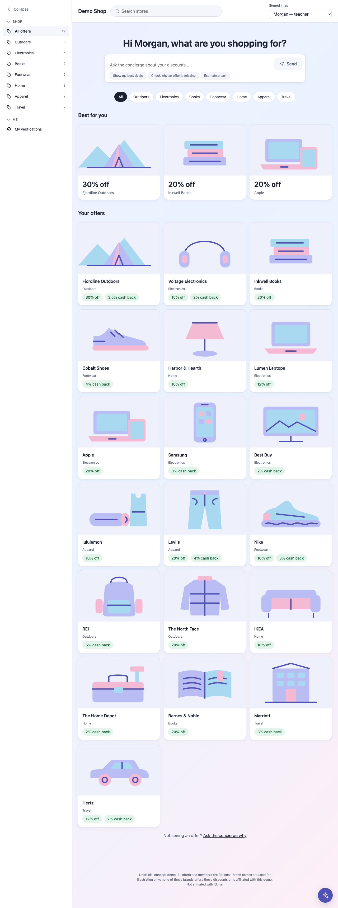
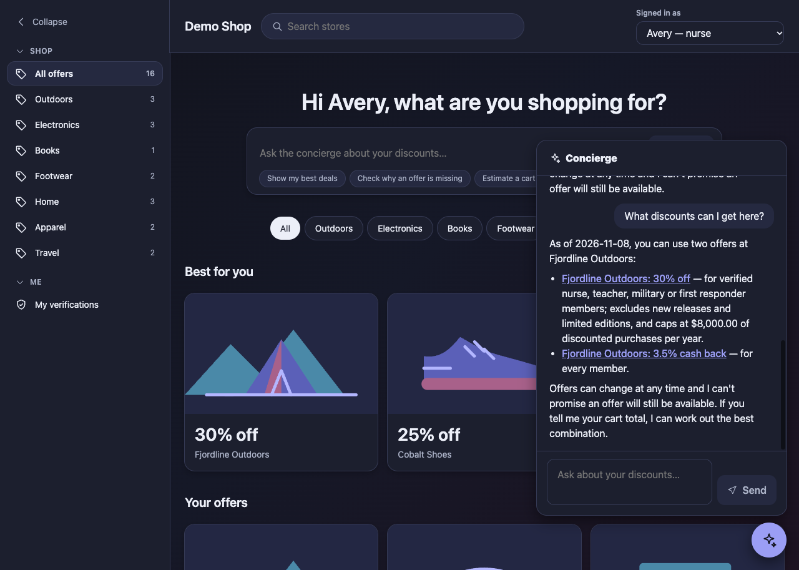

# AI Shop Concierge demo 

## What this is
A small shopping demo that matches discounts to who you are. Pick a demo member and the home page greets you and shows, store by store, only the offers you qualify for. Not seeing one you expected? Ask the concierge why (verification expired, annual cap reached, group not verified). The concierge is an AI assistant, reachable from the ask box on the home page or from the floating button; it answers without making up discounts and without exposing other members' data.






**Familiar names, invented offers.** To make a demo recognisable, the catalog includes 13 well-known brands (Apple, lululemon, Nike, Samsung, IKEA and others) with offers I made up, for example teachers get 20% off a new Apple computer and military members get 15% off at lululemon. None of these brands offers these discounts and none is involved: the page footer, every one of these stores' descriptions and the concierge all say so. Brand names are plain text; there are no logos or brand photos, and each store has an original illustration. Set `CONCIERGE_BRAND_OFFERS=off` to leave only the six original invented stores.

## Status
| Part | State |
| --- | --- |
| Fake data (stores, offers, members) | Done |
| Rules engine and tests | Done |
| Tool layer with server-side member binding | Done |
| Assistant loop (`run_assistant`), OpenRouter or Anthropic | Done: tested with a fake client, with the real SDK over a mock transport, and live |
| Identity matching API | Done |
| Shop page redesign, stage 1 (design tokens, sidebar, home, store pages, dark mode that follows the system) | Done |
| Shop page redesign, stage 2 (split view, contextual toolbar) | Waiting for your OK |
| Floating concierge widget (`widget.js`) | Done (MVP, answers arrive whole, not streamed). Offers in answers are links to the store page; the window shows only the title, the suggestions, the messages and the input |
| Live "as of" date | Done: today's real date, or the one in `CONCIERGE_TODAY` |
| Invented offers under 13 familiar brand names, each with its own illustration | Done: on by default, `CONCIERGE_BRAND_OFFERS=off` turns them off |
| "Show my best deals" with no store chosen | Done: one tool call (`list_all_eligible_offers`) lists up to five offers, largest percentage first, as links |
| Eval run and pass rate | TODO (the runner is not wired yet) |
| AI mistakes log | 2 real entries |

## Run
```bash
python3 -m venv .venv && source .venv/bin/activate
pip install -r requirements.txt
cp .env.example .env          # then put your key in .env (git-ignored)
(cd web && npm install && npm run build)
uvicorn app.server:app --reload
# open http://127.0.0.1:8000
```
Without a key the page and the discount matching still work; only the concierge reports that it is not set up.

Tests: `pytest -q` and `cd web && npm test` (plus `npm run typecheck`).
Working on the page: `cd web && npm run build:widget && npm run dev` (Vite proxies the API to port 8000).

## Configuration (`.env`)
| Variable | Meaning |
| --- | --- |
| `OPENROUTER_API_KEY`, `OPENROUTER_MODEL` | Use OpenRouter (cheap models for testing). The model id is not in the code. |
| `ANTHROPIC_API_KEY` (or `ANTHROPIC_AUTH_TOKEN`), `ANTHROPIC_MODEL` | Use Anthropic instead |
| `LLM_PROVIDER` | `openrouter` or `anthropic`. If unset: OpenRouter when its key is set, else Anthropic |
| `CONCIERGE_BRAND_OFFERS` | Optional. `off`, `0`, `false` or `no` leaves only the six original invented stores; anything else (or unset) also shows the 13 brand stores. Read on every request |
| `CONCIERGE_TODAY` | Optional, `YYYY-MM-DD`. Pins the "as of" date (for repeatable demos, evals and tests). Unset means today's real date, in the server's time zone. A bad value is ignored with a warning |

A key for one provider is never sent to the other. Never set `ANTHROPIC_LOG=debug` expecting to see requests: the code keeps the SDK's debug logs off because they contain the member's message.

## Using the widget on another page
```html
<script src="/widget.js" data-store-id="s1" data-store-name="Fjordline Outdoors" defer></script>
```
The page can then call `window.Concierge.setStore(id, name)`, `.open()`, `.close()`, `.ask(text)` (opens the panel and sends a question) and `.setTheme('auto' | 'light' | 'dark')`. The widget lives in a shadow root, so page styles cannot break it. Another origin needs `data-api-base` and CORS on the server (not set up). Links in answers are written as `#/store/<id>`, which resolves against the page that hosts the widget, so they only work on this shop (a `data-link-base` option would fix that for other sites; not built).

## How it works
```
 browser:  shop page (React)  +  widget.js (React in a shadow root)
              |  GET /me /discounts /estimate        |  POST /chat
              v                                      v
 FastAPI (same origin, cookie says WHO)  ---->  assistant loop ---> model (tool use)
              |                                      |
        matching service                        tools (read-only)
              +--------------> rules engine <---------+
```
- **Identity matching** (`app/matching.py`) is plain code: it asks the rules engine, per offer, whether the member qualifies and why not. No model is involved.
- **The assistant** (`app/assistant.py`) can only use the read-only tools in `app/tools.py`, always for the member the server bound to the session.

## Design decisions
1. **The model talks; code decides.** Eligibility and prices are computed by deterministic code and reached through tools, so the assistant cannot invent a discount.
2. **Member binding on the server.** Tools take no member id; the session decides who is asking, so the model cannot read another member's data. The member never travels in a request body or query.
3. **Minimal data to the model.** Tool results carry offers and reason codes, not names, emails or documents.
4. **Untrusted text.** Offer terms are returned as `terms_untrusted`. One fixture offer (`o99`) contains an injection attempt on purpose, and a test and an eval check that it changes nothing. The page renders model text as plain text, with only bold and lists as elements.
5. **Honest about change.** Every answer carries an "as of" date (today's real date, from `app/clock.py`) and makes no guarantee, because offers can change at any time. The concierge window itself shows no fixed disclaimer; the wording comes with each answer.
6. **Helpful over profitable.** Ranking uses the member's total savings only, not what a store pays.
7. **Nobody converts cents.** A live run showed the model turning 130000 cents into "$130.00". The server now produces every dollar string once (`app/money.py`, integer math); the model and the page only copy them. See the first row of [docs/AI_MISTAKES.md](docs/AI_MISTAKES.md).

8. **Only what you qualify for.** The page never shows an offer you do not qualify for, and hides a store with none; the concierge explains why an offer is missing.
9. **Tokens, not literals.** Every colour, radius, spacing step, shadow, font size and motion duration lives in `web/src/design/tokens.css` (light, dark, reduced motion). A test fails if one appears anywhere else, and others check AA contrast in both themes.
11. **Invented offers under familiar names, kept honest.** The brand offers live in their own files (`data/brand_stores.json`, `data/brand_offers.json`) and are merged by `app/catalog.py`; the rules engine is untouched and every test but one file runs on the original six stores. Each brand store's description says the offers are invented, the footer says no brand offers these discounts, and the concierge's rules tell it to say so if asked.
10. **The server writes the links.** When the concierge names an offer you can use, it copies a ready-made link (`link_markdown`, from `app/links.py`) such as `[Cobalt Shoes: 4% cash back](#/store/s4)`, which opens that store page in this shop. The model never builds an address, offers you cannot use get no link, and the page turns a link into a link only when its address is exactly `#/store/<id>`; anything else (`https://...`, `javascript:`, `..`) stays visible text. This stops an offer's untrusted terms text from steering the model into a bad link.

## Design
The look follows [docs/UI_DESIGN.md](docs/UI_DESIGN.md): a calm, Copilot-style design (pastel gradient, intent-first input, collapsible sidebar), with no Microsoft branding. The page is organised like a deals marketplace (categories, featured offers, store tiles, store pages), without any real brand's logo, copy or styling. Dark mode follows the system setting; there is no light/dark switch on the page (the widget still accepts `setTheme` for pages that embed it). Pictures are original illustrations; you can swap in photos you are licensed to use, see [docs/IMAGES.md](docs/IMAGES.md).

## Assumptions (also returned by `best_combination`)
- Cash back is calculated on the amount paid after any group discount.
- Group discounts do not combine; the best one is chosen.
- A verification is valid for 365 days.

## Evals
`evals/questions.json` holds the question set (10 questions); `python -m evals.run_evals` is meant to run it but is not wired yet. Results: _TODO (pass rate, which questions fail and why)_. The checks are keyword heuristics, so they catch obvious errors, not subtle ones. Live spot checks so far (single runs, a few dozen questions, DeepSeek through OpenRouter) are described in the AI mistakes log; they are not a pass rate.

## Known limitations: do not put this on the public internet
- The demo sign-in is a plain cookie: anyone can pick any member. It is not authentication.
- There is no rate limit, and each chat question costs a little money.
- There is no overall time limit per question: normally 1 to 4 seconds, but a stuck model API could hold a request for minutes.
- Prompts go to OpenRouter and the model's host. That is fine for fake data only.
- Each question is answered on its own (the server keeps no conversation history), and answers arrive whole rather than streamed.
- The pictures are illustrations, not photos, until you add licensed ones.
- The demo data ages with the real calendar. Offer o9 (Lumen Laptops 12%) ends 2026-12-31; Avery's nurse verification expires 2027-03-01, Riley's military one 2027-05-10, Morgan's teacher one 2027-09-01 (Sam's student verification has already expired). Set `CONCIERGE_TODAY` to keep a demo or an eval still.
- "Best deals" are ordered by percentage, not by money saved (a 30% discount and a 4% cash back are different kinds of saving); the concierge says so and offers to work out a cart total. Asked with no store chosen, it lists up to five at once (40 of 40 live runs).

## AI mistakes log
See [docs/AI_MISTAKES.md](docs/AI_MISTAKES.md).

## Not built (on purpose)
Real login, a database, deployment, streaming, rate limiting, real store data.
