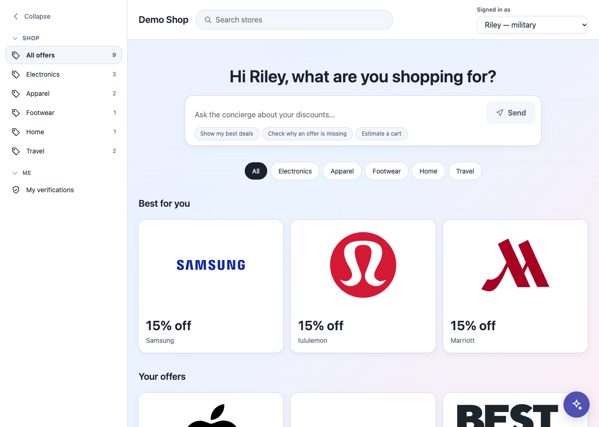
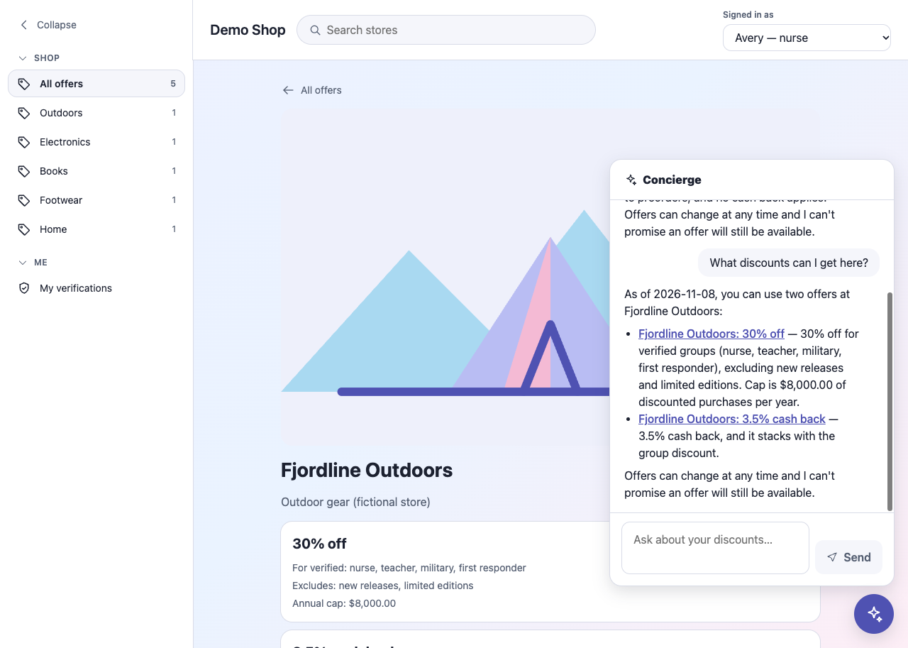

# AI Shop Concierge (demo)

A members-only discount shop with an embeddable AI chat widget that answers from what the member actually qualifies for, without inventing discounts or exposing anyone else's data.

[](https://github.com/GreatDanPeng/AI-Shop-Concierge-demo/actions/workflows/ci.yml) · [Demo video (90 s)](VIDEO_LINK)

> **Disclaimer:** This project is intended solely for personal learning and technical practice. The trademarks, logos and brand elements of Apple, Samsung, Nike, The North Face, IKEA, Marriott, Best Buy, lululemon, Levi's, The Home Depot, Barnes & Noble and Hertz used herein are the property of their respective owners (for example, the Apple trademarks and brand elements are the property of Apple Inc.) and are not used for any commercial purposes. All offers shown are invented; no sponsorship, endorsement or affiliation with any brand, or with ID.me, is implied.

## What it does
Pick a demo member (nurse, student, teacher, military or unverified) and the shop shows only the offers that member qualifies for. Ask the concierge things like *"What can I get here?"*, *"Why isn't my discount showing?"* or *"I'm buying $200 of gear, what do I pay?"* and it answers from the member's verified groups, caps and dates, with an "as of" date and no guarantees.




## Design in five lines
1. **The model talks; code decides.** Eligibility and prices come from deterministic code (integer cents) behind read-only tools, so the assistant cannot invent a discount.
2. **The server decides who is asking.** No tool accepts a member id; the member comes from the session, so the model cannot read another member's data.
3. **Untrusted text stays data.** Offer terms are labelled untrusted. One fixture offer contains a prompt-injection attempt on purpose, and a test and an eval check that it changes nothing.
4. **Nobody asks the model to convert units.** A live run showed it turning 130000 cents into "$130.00", so the server writes every dollar string once.
5. **Honest about change.** Every answer carries an "as of" date and makes no promise that an offer will still be there.

## Evidence
| | |
| --- | --- |
| Tests | 700+ Python tests (`pytest`, no API key needed) and a Vitest suite for the page. CI runs both. |
| Evals | 20 questions through the real assistant loop: 58 of 60 answers passed on the first run, 60 of 60 after two fixes the run found. One model, one day, small samples: a smoke test, not a benchmark. [Details](docs/EVALS.md) |
| Mistakes log | 5 real entries: where the model got something wrong in live checks, how I caught it, what I changed. [docs/AI_MISTAKES.md](docs/AI_MISTAKES.md) |
| History | Small pull requests, tests written first. |

## Try it
```bash
git clone https://github.com/GreatDanPeng/AI-Shop-Concierge-demo.git
cd AI-Shop-Concierge-demo
cp .env.example .env          # optional: add OPENROUTER_API_KEY, or ANTHROPIC_API_KEY plus ANTHROPIC_MODEL, for the chat
docker compose up --build     # then open http://localhost:8000
```
Without a key the shop and the discount matching work; the concierge says it is not set up. Run the tests with `docker compose run --rm app pytest -q`, and the page tests with `cd web && npm ci && npm test`. Running without Docker, every environment variable and how to embed the widget on another page: [docs/CONFIGURATION.md](docs/CONFIGURATION.md).

## Read these first (5 minutes)
| File | What it shows |
| --- | --- |
| [`app/tools.py`](app/tools.py) | The read-only tools; none takes a member id |
| [`app/assistant.py`](app/assistant.py) | The tool-use loop, the system rules and the loop's safety limits |
| [`app/engine.py`](app/engine.py), [`app/matching.py`](app/matching.py) | Eligibility and discount rules in plain code (cents, half-up rounding, no model) |
| [`evals/`](evals/) | The 20 questions and the checks: words, tool calls, links, wrong amounts |
| [`docs/AI_MISTAKES.md`](docs/AI_MISTAKES.md) | What went wrong in live checks and what changed |

## How it works
```
 browser:  shop page (React)  +  widget.js (React in a shadow root)
              |  GET /me /discounts /estimate        |  POST /chat
              v                                      v
 FastAPI (same origin, cookie says WHO)  ---->  assistant loop ---> model (tool use)
              |                                      |
        matching service                        tools (read-only)
              +--------------> rules engine <---------+
```

## Known limits
- The demo sign-in is a plain cookie, not authentication. Do not put this on the public internet.
- No rate limit, and each chat question costs a little; prompts go to a third-party model provider, so fake data only.
- Each question is answered on its own (no conversation history), and answers are not streamed.
- Real brand names and logos appear only on invented offers. A brand can ask for its logo to be removed.
- Not built on purpose: real login, a database, streaming, rate limiting, real store data, cloud deployment.

Full list: [docs/LIMITATIONS.md](docs/LIMITATIONS.md).

## More
[Design decisions](docs/DESIGN.md) · [Configuration and widget embedding](docs/CONFIGURATION.md) · [Evals](docs/EVALS.md) · [UI notes](docs/UI_DESIGN.md) · [Images and logos](docs/IMAGES.md) · [Logo sources](web/public/brands/SOURCES.md) · [Working notes](docs/dev/)

License: MIT for the code. Brand names and logos belong to their owners.
