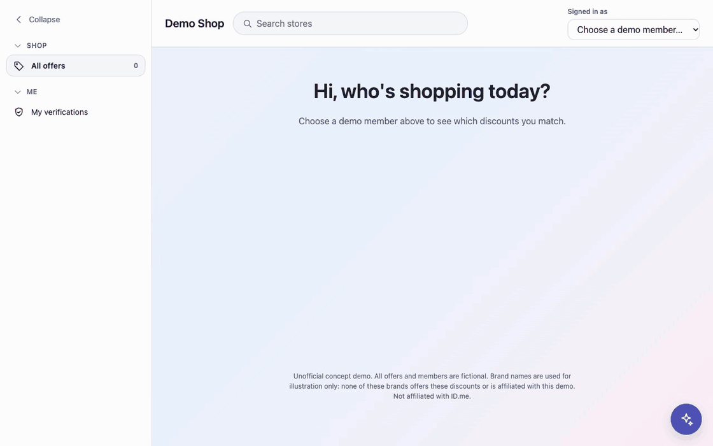

[](https://github.com/GreatDanPeng/AI-Shop-Concierge-demo/actions/workflows/ci.yml)
[](https://codecov.io/gh/GreatDanPeng/AI-Shop-Concierge-demo)
[](LICENSE)

# AI Shop Concierge

<p align="center">
  
</p>

A members-only discount shop with an AI concierge you can embed on any page. Pick a demo member and the shop shows only the offers that member qualifies for; the AI concierge helps users with questions (best deals, why an offer is missing, what a cart costs).

## Features


🎉 User Stories

- [x] Five demo members: nurse, student, teacher, military, unverified
- [x] Only the offers the member qualifies for, across 12 stores
- [x] Cart estimate in exact dollars

🎉 Main Page Concierge

- [x] "Show my best deals" returns offers as links to store pages
- [x] "Why isn't my discount showing?" explains expired, cap reached, not verified
- [x] "I'm buying $1,500 of gear" gives what you pay and what you get back

🎉 Cold-start Framework

- [x] Every agent answer carries a valid date
- [x] OpenRouter or Anthropic, chosen in `.env`
- [x] Docker, CI, 700+ Python and 400+ page tests

## Quick Start

```bash
git clone https://github.com/GreatDanPeng/AI-Shop-Concierge-demo.git
cd AI-Shop-Concierge-demo
cp .env.example .env          # optional: a key turns the chat on
docker compose up --build     # then open http://localhost:8000
```

Tests: `docker compose run --rm app pytest -q` · `cd web && npm ci && npm test`. 
No Docker, env vars, widget embedding: [docs/CONFIGURATION.md](docs/CONFIGURATION.md).

## Evals

- 20 questions run through the real assistant loop: 60/60 tests passed ([docs/EVALS.md](docs/EVALS.md)). 
- 5 real model mistakes and how each was fixed: [docs/AI_MISTAKES.md](docs/AI_MISTAKES.md).

## Docs

- [Design](docs/DESIGN.md) 
- [Configuration](docs/CONFIGURATION.md) 
- [Evals](docs/EVALS.md) 
- [AI mistakes](docs/AI_MISTAKES.md) 
- [UI notes](docs/UI_DESIGN.md) 
- [Images and logos](docs/IMAGES.md) 
- [Limitations](docs/LIMITATIONS.md)

## TODO

- [ ] Real login (sign-in is a demo cookie)
- [ ] Rate limit and a time limit per question
- [ ] Conversation history and streamed answers
- [ ] A database (offers are JSON files) and real store data
- [ ] Cloud deployment with AWS/GCP
- [ ] Widget on another origin (CORS, link base)

## Disclaimer

> **Disclaimer:** This project is intended solely for personal learning and technical practice. The trademarks, logos and brand elements of Apple, Samsung, Nike, The North Face, IKEA, Marriott, Best Buy, lululemon, Levi's, The Home Depot, Barnes & Noble and Hertz used herein are the property of their respective owners (for example, the Apple trademarks and brand elements are the property of Apple Inc.) and are not used for any commercial purposes. All offers shown are invented; no sponsorship, endorsement or affiliation with any brand, or with ID.me, is implied.

License: MIT for the code.
